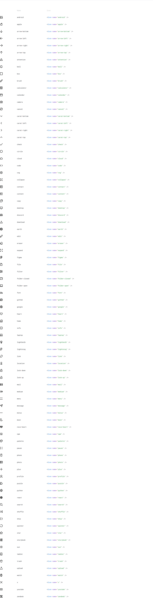

# nice-react-icon


> **Responsive props:** every prop accepts per-breakpoint overrides through the `breakpoints` prop added by `withBreakpoints` (`breakpoints={{ "laptop+": { size: "large" } }}`). Key semantics: nice-react-styles README → "Breakpoint keys".

React icon component for the nice-icons set, with token-driven sizing, color, and stroke, optional vendor (Lucide) resolution, and an `Illustration` component for fixed-color art.

## Installation

```bash
npm install nice-react-icon nice-react-icon-vendor
```

Peer dependencies: `react`, `react-dom`, `styled-components`, `nice-styles`, `nice-react-styles`, `nice-react-icon-vendor`.

## Quick Start

```tsx
import Icon from "nice-react-icon"

<Icon name="star" />
<Icon name="star" variant="fill" size="large" color="success" />
```

## Props Reference

Types are the aliases exported from `Icon.types.ts`. Allowed values of each union (resolved): `~/nice/manifest/agents/catalog.json` → `nice-react-icon`; aliases imported from nice-styles (`FontSizeType`, `ColorType`, `ThemeType`) stay unresolved there — read `nice-styles/src/generated/types.ts`.

| Prop | Type | Default | Description |
|------|------|---------|-------------|
| `name` | `IconNameType \| (string & {})` | `"circle"` | Built-in name (`iconNames`), or a vendor name with `vendor`. An unresolved name renders `circle` |
| `variant` | `IconVariantType` | `"base"` | Variant stem the icon ships: `"base"` (outline), `"fill"`, or any other the icon ships; an unknown variant renders `"base"` and warns |
| `outlined` | `boolean` | `false` | Deprecated — use `variant`. `true` maps to `variant="fill"` |
| `url` | `string` | - | Image URL rendered in place of the built-in SVG (built-in names only) |
| `color` | `ColorTokenProp<IconColorType>` | `"base"` | Color token variant, or an object with effects |
| `size` | `IconSizeType` | `"base"` | Size token variant (`icon.size`); sets width and height |
| `viewBox` | `string` | `"0 0 16 16"` | SVG viewBox override |
| `strokeWidth` | `IconStrokeWidthType` | `"base"` | Stroke width token variant (`icon.strokeWidth`) |
| `strokeScaling` | `boolean` | `false` | `false` keeps the stroke width fixed at any icon size (`vector-effect: non-scaling-stroke` on the SVG shapes); `true` lets the stroke scale with the icon |
| `darkAntialiasing` | `boolean` (optional) | follows the theme | Thins the stroke for dark mode by multiplying it by `icon.strokeWidthScale`, which follows the root `strokeWidthScale` (`1` in day, `0.9` in night). Unset follows the nearest theme (`<Theme>`, `data-theme`, the icon's `theme`, else the OS preference); `true` thins in any theme; `false` never thins |
| `theme` | `ThemeType` | - | Pins the icon to a theme (wraps it in `<Theme>`) |
| `vendor` | `boolean` | `false` | Resolve names not in the built-in set through the registered vendor resolver |
| `vendorComponent` | `React.ComponentType` | - | Renders this component inside the icon wrapper with token styling; bypasses name resolution |
| `animation` | `IconAnimationType` | - | Named animation (`"spin"`). `spinner` spins without it |
| `animationDuration` | `IconAnimationDurationType` | `"base"` | Animation speed token variant (`icon.animationDuration`) |
| `style` | `React.CSSProperties` | - | Inline styles on the root element |
| `className` | `string` | - | Class on the root element |

### Illustration

`import { Illustration } from "nice-react-icon"` — fixed-color art from nice-icons' illustration set. Recolor and stroke props (`color`, `strokeWidth`, `strokeScaling`, `outlined`) are omitted; sizing and animation reuse the icon tokens.

| Prop | Type | Default | Description |
|------|------|---------|-------------|
| `name` | `IllustrationNameType \| (string & {})` | `"nice-heart"` | Illustration name |
| `variant` | `IconVariantType` | `"base"` | Variant the illustration ships |
| `size` | `IconSizeType` | `"base"` | Size token variant |
| `viewBox` | `string` | `"0 0 16 16"` | SVG viewBox override |
| `theme` | `ThemeType` | - | Pins the illustration to a theme |
| `animation` | `IconAnimationType` | - | Named animation (`"spin"`) |
| `animationDuration` | `IconAnimationDurationType` | `"base"` | Animation speed token variant |
| `style` | `React.CSSProperties` | - | Inline styles on the root element |
| `className` | `string` | - | Class on the root element |

## Vendor Icons

Names not in the built-in set can be resolved through `nice-react-icon-vendor`, an optional peer package that registers a resolver as a side effect of being imported.

```tsx
// Once, at the app entry
import "nice-react-icon-vendor"

// Anywhere
<Icon name="TrendingDown" vendor />
```

Vendor names are Lucide's PascalCase names (`TrendingDown`, `Pencil`); a name Lucide does not have renders `circle`. Built-in names win: a vendor name that matches a built-in name renders the built-in icon. Without the import, `vendor` names render `circle`.

### Why a separate peer package

The vendor peer package is part of Nice's commitment to remaining as agnostic as possible from third-party libraries. The host component (`nice-react-icon`) never imports the third-party icon set directly; it exposes a `vendor` flag and a `registerVendorResolver` hook, and the peer package is the only place a concrete vendor (currently Lucide) is referenced. This reserves the right to swap, supplement, or remove the third-party dependency later without touching the host component or any consumer call site.

The same pattern applies to `nice-react-image` / `nice-react-image-vendor`.

## Icon names

Built-in names and their variants come from nice-icons: `import { iconNames } from "nice-react-icon"` (the `IconNameType` union). Add icons by adding them to nice-icons and rebuilding it.

## Usage Examples

```tsx
import Icon, { Illustration } from "nice-react-icon"

<Icon name="star" variant="fill" />                         // filled variant
<Icon name="star" size="larger" strokeWidth="large" />      // token size and stroke
<Icon name="star" color="error" theme="night" />            // color token, pinned theme
<Icon name="spinner" />                                     // spins by default
<Icon name="star" animation="spin" animationDuration="slow" />
<Icon name="TrendingDown" vendor />                         // Lucide (needs nice-react-icon-vendor)
<Icon vendorComponent={MyIcon} color="success" />           // custom component, token styling
<Icon breakpoints={{ "laptop+": { size: "large" } }} />     // responsive override
<Illustration name="nice-heart" size="larger" />
```

## Tokens

Component tokens under the `icon` prefix (`~/nice/styles/src/tokens/components/icon.json`): `size`, `color`, `strokeWidth`, `strokeWidthScale`, `animationDuration`, `viewBox`. Override them with `setTokens({ icon: { … } })` from nice-react-styles; read them with `getToken("icon.size:base")`.

## TypeScript

```tsx
import Icon, { type IconProps, type IconNameType, IconTypes, Illustration, type IllustrationProps, iconNames, registerVendorResolver } from "nice-react-icon"
```

`registerVendorResolver(fn)` registers the resolver used by `vendor` (`(name: string) => React.ComponentType | null`); nice-react-icon-vendor calls it on import.

## License

MIT © Nice Prototypes
